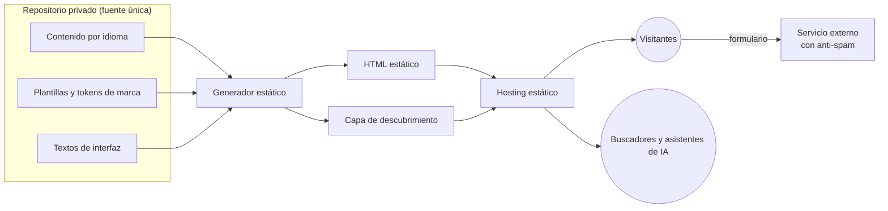

# Web corporativa bilingüe para un estudio de arquitectura

🇬🇧 [English version](README.md)

> **Estado:** en producción en el dominio propio del estudio.
> **Rol:** dirección técnica y de producto de principio a fin.

Sitio web estático y bilingüe para un estudio de arquitectura y reformas, con catálogo de proyectos, formulario de contacto y optimización para buscadores tradicionales y generativos.

---

## 🎯 El problema

El estudio necesitaba una presencia digital propia que:

- estuviera a la altura de una marca premium;
- se encontrara en búsquedas locales y en asistentes de IA;
- tuviera un coste y un mantenimiento técnico mínimos.

Además, el equipo del estudio no edita código.

---

## 🧭 Mi rol y método

La implementación se hizo con asistencia de IA bajo mi dirección y revisión.

- **Arquitectura y stack:** elegí un generador estático y descarté un CMS dinámico.
- **Idiomas y URLs:** definí la estrategia de ambos.
- **Modelo de contenido:** qué datos tiene un proyecto y qué no se publica nunca.
- **Movimiento y accesibilidad:** fijé los principios a partir del manual de marca.
- **Normas editoriales:** dirigí la curación fotográfica, con dos reglas: no usar imágenes generadas que simulen obra y no inventar datos de proyecto.
- **Posicionamiento:** estrategia orgánica, local y en buscadores generativos.
- **Producción:** llevé el sitio a producción y lo mantengo.
- **Comunicación con el estudio:** traduje las decisiones técnicas a informes y presentaciones para un equipo no técnico.

---

## ⚙️ Arquitectura

- **Generador de sitio estático:** convierte plantillas y archivos de contenido versionados en HTML. No hay base de datos ni servidor de aplicación.
- **Capa de contenido:** cada proyecto es un archivo por idioma, con fotos y unos pocos campos factuales. Los textos de interfaz están centralizados por idioma.
- **Capa de presentación:** plantillas reutilizables (inicio, listado con filtro, ficha de proyecto, estudio, servicios, equipo y contacto) y una hoja de estilos con tokens de marca. El JavaScript es ligero y solo mejora la experiencia: navegación móvil, animaciones de entrada, filtro y envío del formulario.
- **Servicios externos mínimos:** el formulario envía a un servicio de terceros, con confirmación dentro de la página y protección anti-spam.
- **Capa de descubrimiento,** generada en cada build: metadatos, datos estructurados, sitemap, robots, un archivo legible por modelos de lenguaje e imagen para redes recortada automáticamente de la foto de cada proyecto.

---

## 🧩 Decisiones clave

### 1. Estático en lugar de un CMS tradicional
- **Por qué:** alojamiento casi gratuito, superficie de ataque mínima, carga rápida y prácticamente ningún mantenimiento.
- **Contrapartida:** no hay panel de edición nativo y cada cambio exige un build.

### 2. Bilingüe nativo: idioma principal en la raíz y secundario en un subdirectorio
- **Por qué:** URLs limpias para el mercado principal, sin redirección inicial, y mejor SEO local.
- **Contrapartida:** el contenido se duplica por idioma, y si falta una traducción esa URL da error.

### 3. Modelo de contenido mínimo y factual, con taxonomía cerrada
- **Por qué:** no se publica nada que no se pueda verificar. El tipo de proyecto es un valor fijo, así que el filtro es fiable, y solo aparece cuando hay variedad real.
- **Contrapartida:** fichas austeras, cuya calidad depende mucho de la fotografía.

### 4. Movimiento con mejora progresiva
- **Por qué:** la web debe sentirse viva sin competir con la foto. El contenido se ve aunque el JavaScript falle o no cargue, y se respeta la preferencia de movimiento reducido.
- **Contrapartida:** efectos más contenidos y más pruebas en distintos dispositivos.

### 5. Diseñada para ser citada, no solo indexada
- **Por qué:** el sitio describe en prosa clara quién es el estudio, qué hace y dónde, y genera automáticamente la capa para buscadores y asistentes de IA.
- **Contrapartida:** los campos vacíos se notan en esa capa, y el texto alternativo de las fotos se sigue escribiendo a mano.

---

## ⏳ Evolución

1. Maqueta de diseño para fijar la dirección visual y el movimiento.
2. Implementación con despliegue continuo desde el repositorio.
3. Diseño responsive con menú móvil a pantalla completa.
4. Secciones nuevas: proyectos con filtro, contacto con envío sin recarga y servicios. La sección de proceso se sustituyó por la de equipo a petición del estudio.
5. Capa de SEO, SEO local y buscadores generativos, con imagen social automática por proyecto.

---

## 📊 Resultados

Sitio bilingüe completo en producción, con un catálogo de proyectos reales publicado en los dos idiomas. No se han medido tráfico, conversiones ni rendimiento.

---

## 🛠 Stack

Hugo · HTML, CSS y JavaScript sin frameworks de cliente · contenido en Markdown con metadatos estructurados · GitHub (repositorio privado) · hosting estático · sin base de datos.
