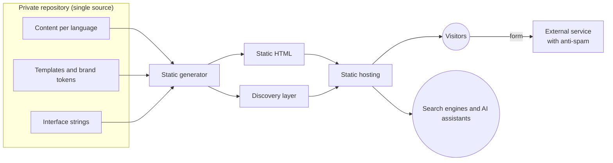

# Bilingual Corporate Website for an Architecture Studio

🇪🇸 [Versión en español](README.es.md)

> **Status:** in production on the studio's own domain.
> **Role:** end-to-end technical and product lead.

A static, bilingual website for an architecture and renovation studio, with a project catalogue, a contact form, and optimisation for both traditional and generative search engines.

---

## 🎯 The problem

The studio needed its own digital presence that would:

- live up to a premium brand;
- be found in local searches and by AI assistants;
- have minimal cost and technical maintenance.

On top of that, the studio's team doesn't edit code.

---

## 🧭 My role and approach

The implementation was done with AI assistance under my direction and review.

- **Architecture and stack:** I chose a static site generator and ruled out a dynamic CMS.
- **Languages and URLs:** I defined the strategy for both.
- **Content model:** what data a project has and what is never published.
- **Motion and accessibility:** I set the principles based on the brand guidelines.
- **Editorial rules:** I led the photo curation, with two rules: no generated images that pass for real work, and no invented project data.
- **Search positioning:** organic, local and generative search strategy.
- **Production:** I took the site to production and maintain it.
- **Communication with the studio:** I translated technical decisions into reports and presentations for a non-technical team.

---

## ⚙️ Architecture

- **Static site generator:** turns templates and versioned content files into HTML. No database and no application server.
- **Content layer:** each project is one file per language, with photos and a few factual fields. Interface strings are centralised per language.
- **Presentation layer:** reusable templates (home, filterable listing, project page, studio, services, team and contact) and a stylesheet with brand tokens. JavaScript is light and only enhances the experience: mobile navigation, entrance animations, filtering and form submission.
- **Minimal external services:** the form posts to a third-party service, with in-page confirmation and spam protection.
- **Discovery layer,** generated on every build: metadata, structured data, sitemap, robots, an LLM-readable file, and a social image automatically cropped from each project's photo.

---

## 🧩 Key decisions

### 1. Static instead of a traditional CMS
- **Why:** near-free hosting, minimal attack surface, fast loading and practically no maintenance.
- **Trade-off:** no native editing panel, and every change requires a build.

### 2. Natively bilingual: primary language at the root and the second in a subdirectory
- **Why:** clean URLs for the main market, no initial redirect, and better local SEO.
- **Trade-off:** content is duplicated per language, and if a translation is missing that URL returns an error.

### 3. A minimal, factual content model with a closed taxonomy
- **Why:** nothing that can't be verified gets published. Project type is a fixed value, so the filter is reliable, and it only appears when there is real variety.
- **Trade-off:** sparse project pages whose quality depends heavily on photography.

### 4. Motion with progressive enhancement
- **Why:** the site should feel alive without competing with the photos. Content is visible even if JavaScript fails or doesn't load, and the reduced-motion preference is respected.
- **Trade-off:** more restrained effects and more testing across devices.

### 5. Designed to be cited, not just indexed
- **Why:** the site describes in plain prose who the studio is, what it does and where, and automatically generates the layer for search engines and AI assistants.
- **Trade-off:** empty fields show up in that layer, and photo alt text is still written by hand.

---

## ⏳ Evolution

1. Design mock-up to set the visual direction and motion.
2. Implementation with continuous deployment from the repository.
3. Responsive design with a full-screen mobile menu.
4. New sections: filterable projects, contact with no-reload submission, and services. The process section was replaced by a team section at the studio's request.
5. SEO, local SEO and generative search layer, with an automatic social image per project.

---

## 📊 Results

A complete bilingual site in production, with a catalogue of real projects published in both languages. Traffic, conversions and performance have not been measured.

---

## 🛠 Stack

Hugo · HTML, CSS and JavaScript without client-side frameworks · Markdown content with structured metadata · GitHub (private repository) · static hosting · no database.
