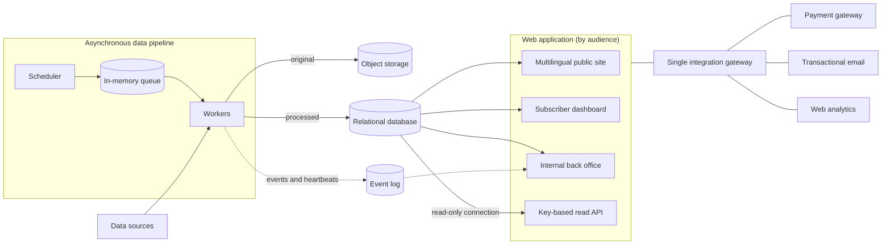

# Arpada Trading: Market Intelligence SaaS Platform

🇪🇸 [Versión en español](README.es.md)

> **Status:** in production, in closed beta ahead of public launch.
> **Role:** technical and product lead.

A subscription web platform that gathers, every day, information about listed companies that is scattered across many sources and hard to interpret, and presents it in a single dashboard. The content is descriptive and has two reading levels, one for beginners and one for experienced readers. It informs, but does not recommend.

---

## 🧭 My role and approach

I don't write the code: I define what gets built, how and in what order, and I take the system to production.

- **Architecture:** separation by audience, asynchronous data pipeline, storage and payment integration.
- **Leading development:** implementation is carried out by AI coding agents under my direction. I set the rules they must follow and approve every change.
- **System recovery:** after a period of low-quality code, I took inventory, prioritised work by risk rather than annoyance, and set one rule: nothing is touched unless we can first prove the change doesn't break anything.
- **Written criteria:** a binding decision log, with the reasoning and accepted cost of each decision, and an operations manual describing the system as it actually runs today.
- **Quality and observability:** testing strategy and logging policy (what is logged, at what level and for how long it is kept).
- **Product and compliance:** subscription model, billing, consent-based communications and privacy (GDPR).
- **Operations:** deployments, production migrations and infrastructure incident resolution.

---

## ⚙️ Architecture

- **Modular web application, split by audience rather than by feature:** multilingual public site, subscriber dashboard, internal back office with statistics and an event log, and a key-authenticated read API with its management console.
- **Asynchronous data pipeline:** a scheduler launches periodic tasks that background workers execute. They all follow the same pattern: acquire the data, store the original, process it and load it into the database. Each step chains the next.
- **Relational database with two connections:** a general one and a read-only one for the API, with per-table permissions.
- **Shared in-memory store** for caching and the message queue.
- **Object storage** acting as a data lake for the original data.
- **External integrations** (payments synchronised via webhooks, transactional email and analytics), all through a single control point.
- **In-house observability:** a persistent log with level, origin and per-level retention, searchable from the back office, plus "heartbeats" that raise an alert when a scheduled process stops running.

---

## 🧩 Key decisions

### 1. Always store the original data before processing it
- **Why:** if processing fails or the logic changes, data can be reprocessed without paying for acquisition again.
- **Trade-off:** more storage and the need for automatic age-based cleanup.

### 2. Tasks that chain into each other, with no orchestrator
- **Why:** it's simple, every task is independent, and a failure doesn't block the queue.
- **Trade-off:** there is no "pipeline finished" signal. The event log's heartbeats compensate for that.

### 3. Idempotent payment synchronisation
- **Why:** the gateway's notification only says what changed, and the real state is always fetched from the gateway. Duplicate or out-of-order notifications corrupt nothing, and no processed-events table is needed.
- **Trade-off:** one extra call to the gateway per event.

### 4. Configuration that fails at startup
- **Why:** it came out of a real incident. Silent defaults made the system appear to work with incorrect configuration, without raising any error. Secrets are now mandatory and have no default value.
- **Trade-off:** if a variable is missing, the application won't start. That is exactly the point: turning a silent failure into a visible one.

### 5. The system computes the facts; the text only describes them
- **Why:** figures are computed and stored as versioned structured data, and the text is generated at display time, in each user's language and without making recommendations, because financial advice is regulated. This leaves AI ready to come in only as a writer, never as a source of figures.
- **Trade-off:** text that is more rigid than free writing, plus versioning of the data format.

---

## 🔌 Data distribution API

At first, the processed data could only be seen on the platform's own website. The API distributes it in a controlled way to other internal products (automated content generation, the newsletter and other systems), without duplicating data acquisition and without putting the production platform at risk.

- **Versioned read-only JSON endpoints**, with per-application keys and scoped permissions.
- **Database access through a read-only user**, via a dedicated router.
- **Rate limiting and auditing of every request**, backed by the in-memory store.
- **Management console in the back office**, for internal staff only: create, view, expire and revoke keys, and monitor usage and failed requests.

### API decisions

1. **A central source instead of custom integrations.**
   - **Why:** every derived product draws on a single source, without duplicating data acquisition or logic.
   - **Trade-off:** it currently shares deployment and resources with the website. Splitting it into its own service is planned.
2. **Read-only database user.**
   - **Why:** even if a key leaks or the API fails, nobody can modify data from outside.
   - **Trade-off:** every new table requires granting permissions by hand in production.
3. **Per-application keys with scopes, expiry, hashed storage, auditing and rate limiting.**
   - **Why:** every consumer is controlled and revoked independently, and every request is traced.
   - **Trade-off:** a lost key can't be recovered and a new one must be issued, and the access log needs a purge policy.
4. **In-house management console instead of the provider's panel or the framework admin.**
   - **Why:** day-to-day key management had to be convenient and self-sufficient.
   - **Trade-off:** one more component to maintain inside the back office.

---

## ⏳ Evolution

| Area | Before | Now |
| :--- | :--- | :--- |
| Infrastructure | Self-managed servers with remote-script deployment. | Managed platform deploying straight from the repository; the old workflow was fully retired. |
| Storage | Files on local disk. | Cloud object storage. |
| Code | A period of defective code. | About 570 lines of dead code removed and a single access point for storage and external services. |
| Quality | No tests. | About 350 automated tests and a containerised local environment that mirrors production. |
| Observability | No logging. | Event system with levels, origin, retention and heartbeats. |
| Interface | Generic CSS framework. | In-house design system, with no third-party dependencies in the main dashboard. |
| Product | A data tool. | A complete SaaS: subscriptions, billing, consent-based communications, legal pages, analytics and five languages. |
| Distribution | Data visible only on the website itself. | Versioned read-only API (since August 2026) with a key console, a configurable time window, standard identifiers to cross-reference external sources, and complete technical documentation for integrating new systems. |

---

## 📊 Scale and results

- More than 3,700 listed companies updated every trading day, and about 10,000 in the search index.
- 9 scheduled processes (daily, weekly and monthly).
- Production on 3 components (web, workers and scheduler) and 2 managed databases, for about $15 a month.
- About 350 automated tests that run in about 40 seconds.
- 5 languages.
- API in production with 2 endpoints and 2 internal products consuming it; a third is being integrated.

There are no user or revenue metrics yet: the platform is in closed beta.

---

## 🛠 Stack

Python · Django · Celery · Redis/Valkey · PostgreSQL · DigitalOcean App Platform · S3-compatible object storage · Stripe · Docker (local environment) · HTML/CSS/JS without frontend frameworks.
