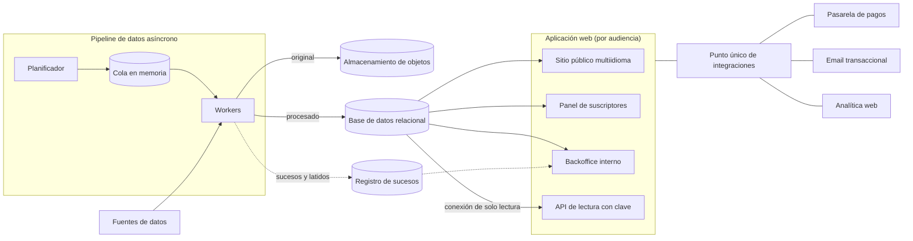

# Arpada Trading: Plataforma SaaS de inteligencia de mercados

> **Estado:** en producción, en beta cerrada previa al lanzamiento público.
> **Rol:** director técnico y de producto.

Plataforma web por suscripción que reúne cada día información sobre empresas cotizadas, dispersa en muchas fuentes y difícil de interpretar, y la presenta en un único panel. El contenido es descriptivo y tiene dos niveles de lectura, uno para quien empieza y otro para quien domina la materia. Informa, pero no recomienda.

---

## 🧭 Mi rol y método

No escribo el código: defino qué se construye, cómo y en qué orden, y llevo el sistema a producción.

- **Arquitectura:** separación por audiencias, pipeline de datos asíncrono, almacenamiento e integración de pagos.
- **Dirección del desarrollo:** la implementación la ejecutan agentes de IA de programación bajo mi dirección. Yo fijo las reglas que deben seguir y apruebo cada cambio.
- **Recuperación del sistema:** tras una etapa de código de baja calidad, hice inventario, ordené el trabajo por riesgo y no por molestia, y fijé una regla: no se toca nada sin poder demostrar antes que el cambio no rompe nada.
- **Criterios por escrito:** un registro de decisiones vinculante, con el porqué y el coste asumido de cada una, y un manual de operaciones que describe el sistema tal como funciona hoy.
- **Calidad y observabilidad:** estrategia de pruebas y política de registro (qué se registra, con qué nivel y cuánto tiempo se guarda).
- **Producto y cumplimiento:** modelo de suscripción, facturación, comunicaciones con consentimiento y privacidad (RGPD).
- **Operación:** despliegues, migraciones en producción y resolución de incidencias de infraestructura.

---

## ⚙️ Arquitectura

- **Aplicación web modular, dividida por audiencia y no por funcionalidad:** sitio público multiidioma, panel de suscriptores, backoffice interno con estadísticas y registro de sucesos, y una API de lectura autenticada por clave, con su consola de gestión.
- **Pipeline de datos asíncrono:** un planificador lanza tareas periódicas que ejecutan workers en segundo plano. Todas siguen el mismo patrón: adquirir los datos, guardar el original, procesarlo y volcarlo a la base de datos. Cada paso encadena el siguiente.
- **Base de datos relacional con dos conexiones:** una general y otra de solo lectura para la API, con permisos por tabla.
- **Almacén en memoria compartido** para caché y cola de mensajes.
- **Almacenamiento de objetos** que hace de data lake de los datos originales.
- **Integraciones externas** (pagos sincronizados por webhooks, email transaccional y analítica), todas a través de un único punto de control.
- **Observabilidad propia:** registro persistente con nivel, origen y retención por nivel, consultable desde el backoffice, y «latidos» que avisan cuando un proceso programado deja de ejecutarse.

---

## 🧩 Decisiones clave

### 1. Guardar siempre el dato original antes de procesarlo
- **Por qué:** si el procesado falla o cambia la lógica, se reprocesa sin volver a pagar la adquisición.
- **Contrapartida:** más almacenamiento y la necesidad de una limpieza automática por antigüedad.

### 2. Tareas que se encadenan entre sí, sin orquestador
- **Por qué:** es simple, cada tarea es independiente y un fallo no bloquea la cola.
- **Contrapartida:** no existe una señal de «pipeline terminado». Se compensa con los latidos del registro de sucesos.

### 3. Pagos sincronizados de forma idempotente
- **Por qué:** el aviso de la pasarela solo indica qué ha cambiado, y el estado real se consulta siempre a la pasarela. Así, los avisos duplicados o fuera de orden no corrompen nada y no hace falta una tabla de eventos procesados.
- **Contrapartida:** una llamada extra a la pasarela por cada evento.

### 4. Configuración que falla al arrancar
- **Por qué:** nació de una incidencia real. Valores por defecto silenciosos hacían que el sistema pareciera funcionar con una configuración incorrecta, sin dar ningún error. Ahora los secretos son obligatorios y no tienen valor por defecto.
- **Contrapartida:** si falta una variable, la aplicación no arranca. Es exactamente lo que se busca: convertir un fallo silencioso en uno visible.

### 5. El sistema calcula los hechos; el texto solo los describe
- **Por qué:** las cifras se calculan y se guardan como datos estructurados con versión, y el texto se redacta al mostrarlo, en el idioma de cada usuario y sin formular recomendaciones, porque el asesoramiento financiero está regulado. Esto deja preparada la entrada de la IA solo como redactora, nunca como fuente de cifras.
- **Contrapartida:** textos más rígidos que una redacción libre y gestión de versiones del formato de los datos.

---

## 🔌 API de distribución de datos

Al principio, los datos procesados solo podían verse en la web de la plataforma. La API los distribuye de forma controlada a otros productos internos (generación automática de contenido, newsletter y otros sistemas), sin repetir la captura de datos y sin poner en riesgo la plataforma en producción.

- **Endpoints versionados de solo lectura en JSON**, con clave por aplicación y permisos por alcance.
- **Acceso a la base de datos mediante un usuario de solo lectura**, a través de un enrutador dedicado.
- **Límite de peticiones y auditoría de cada acceso**, apoyados en el almacén en memoria.
- **Consola de gestión en el backoffice**, solo para personal interno: crear, consultar, caducar y revocar claves, y seguir el uso y los accesos fallidos.

### Decisiones de la API

1. **Una fuente central en lugar de integraciones a medida.**
   - **Por qué:** todos los productos derivados salen de una sola fuente, sin duplicar la captura ni la lógica de datos.
   - **Contrapartida:** hoy comparte despliegue y recursos con la web. Está previsto separarla en un servicio propio.
2. **Usuario de base de datos de solo lectura.**
   - **Por qué:** aunque se filtre una clave o falle la API, nadie puede modificar datos desde fuera.
   - **Contrapartida:** cada tabla nueva exige conceder permisos a mano en producción.
3. **Claves por aplicación con alcances, caducidad, almacenamiento en hash, auditoría y límite de peticiones.**
   - **Por qué:** cada consumidor se controla y se revoca por separado, y todo acceso queda trazado.
   - **Contrapartida:** una clave perdida no se recupera, hay que emitir otra, y el registro de accesos necesita una política de purga.
4. **Consola de gestión propia en vez del panel del proveedor o el admin del framework.**
   - **Por qué:** la gestión diaria de claves tenía que ser cómoda y autónoma.
   - **Contrapartida:** una pieza más que mantener dentro del backoffice.

---

## ⏳ Evolución

| Área | Antes | Ahora |
| :--- | :--- | :--- |
| Infraestructura | Servidores propios con despliegue por script remoto. | Plataforma gestionada que despliega directamente desde el repositorio; el flujo antiguo se retiró del todo. |
| Almacenamiento | Ficheros en disco local. | Almacenamiento de objetos en la nube. |
| Código | Etapa de código defectuoso. | Unas 570 líneas de código muerto eliminadas y un único punto de acceso al almacenamiento y a los servicios externos. |
| Calidad | Ninguna prueba. | Unas 350 pruebas automatizadas y un entorno local en contenedores que replica producción. |
| Observabilidad | Sin registro. | Sistema de sucesos con niveles, origen, retención y latidos. |
| Interfaz | Framework CSS genérico. | Sistema de diseño propio, sin dependencias de terceros en el panel principal. |
| Producto | Herramienta de datos. | SaaS completo: suscripciones, facturación, comunicaciones con consentimiento, páginas legales, analítica y cinco idiomas. |
| Distribución | Datos visibles solo en la propia web. | API versionada de solo lectura (desde agosto de 2026) con consola de claves, ventana temporal configurable, identificadores estándar para cruzar con fuentes externas y documentación técnica completa para integrar nuevos sistemas. |

---

## 📊 Escala y resultados

- Más de 3.700 empresas cotizadas actualizadas cada día de mercado, y unas 10.000 en el índice de búsqueda.
- 9 procesos programados (diarios, semanales y mensuales).
- Producción en 3 componentes (web, workers y planificador) y 2 bases de datos gestionadas, por unos 15 $ al mes.
- Unas 350 pruebas automatizadas que se ejecutan en unos 40 segundos.
- 5 idiomas.
- API en producción con 2 endpoints y 2 productos internos consumiéndola; un tercero en integración.

Todavía no hay métricas de usuarios ni de ingresos: la plataforma está en beta cerrada.

---

## 🛠 Stack

Python · Django · Celery · Redis/Valkey · PostgreSQL · DigitalOcean App Platform · almacenamiento de objetos compatible con S3 · Stripe · Docker (entorno local) · HTML/CSS/JS sin frameworks de frontend.
