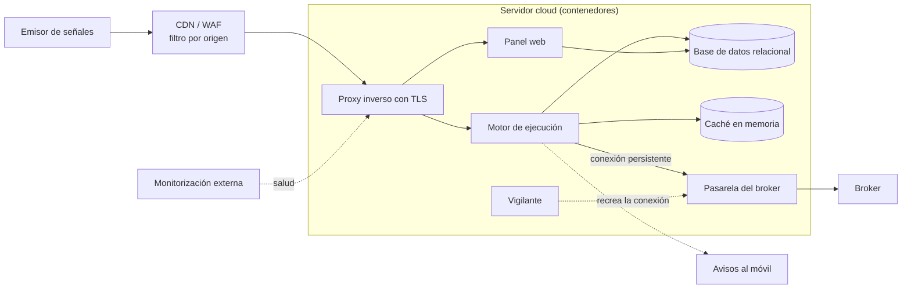

# Motor de ejecución automatizada de órdenes

> **Estado:** en producción en modo simulado (paper trading) y en uso diario desde octubre de 2026. El paso a operativa real está pendiente de ajustes de autenticación y supervisión.
> **Rol:** director del proyecto, de punta a punta.

Plataforma que recibe señales de trading generadas en una herramienta externa y las convierte en órdenes en un broker, sin intervención manual y las 24 horas. Cada operación queda registrada de principio a fin, y los resultados se consultan por día, semana y mes en un panel de control.

Antes, la ejecución dependía de procesos frágiles y no había una forma fiable de conocer el resultado real.

---

## 🧭 Mi rol y método

No escribo el código: el código lo producen asistentes de IA bajo mi dirección y revisión.

- **Objetivos y fases:** primero un flujo mínimo que funcione, después robustez y, por último, que se pueda replicar.
- **Arquitectura y stack:** tomé las decisiones técnicas, incluida la de rechazar una propuesta más simple que no aguantaba el uso en producción.
- **Prioridades técnicas:** seguridad frente a órdenes duplicadas, recuperación automática y trazabilidad completa.
- **Criterios de aceptación:** por ejemplo, pruebas de concurrencia antes de confiar en el sistema.
- **Operación:** despliegue, servidor e incidentes en producción.
- **Producto e interfaz:** rediseño del panel con un sistema de diseño propio.
- **Documentación:** encargué y validé un manual de usuario y una guía técnica.

---

## ⚙️ Arquitectura

- **Perímetro:** una CDN con WAF solo deja pasar el tráfico del emisor de señales. Detrás, un proxy inverso con TLS es el único componente expuesto a internet.
- **Motor de ejecución:** servicio asíncrono que valida cada señal, la autentica con un token por bot y la procesa con exclusión mutua y control del estado de la posición. Habla con el broker por una única conexión persistente y ejecuta también tareas programadas, como los cierres de fin de sesión y los resúmenes.
- **Pasarela del broker:** aislada en su propio contenedor.
- **Panel web:** gestión de bots y webhooks, historial de operaciones, resúmenes de resultados y gestión de cuenta con credenciales cifradas. Acceso restringido y sin indexación.
- **Datos:** una base de datos relacional compartida por el motor y el panel, más una caché en memoria para las validaciones frecuentes.
- **Supervisión:** un vigilante recrea la conexión con el broker si cae; un endpoint de salud con monitorización externa, y avisos al móvil con el resumen diario y las desconexiones.

---

## 🧩 Decisiones clave

### 1. Separar el motor de ejecución del panel web
- **Por qué:** latencia baja en la ruta crítica, y un fallo o un despliegue del panel nunca bloquea una orden.
- **Contrapartida:** dos aplicaciones que mantener sobre una base de datos compartida, con cambios de esquema coordinados.

### 2. Quitar la cola de tareas y dejar la caché solo como caché
- **Por qué:** menos piezas móviles, menos latencia y menos puntos de fallo para un volumen de señales moderado.
- **Contrapartida:** se renuncia al escalado horizontal del procesamiento. Si el volumen crece mucho, habrá que reintroducirla.

### 3. Ante la duda, pausar en lugar de reintentar
Un candado por bot y una máquina de estados de la posición garantizan que una orden nunca se duplica. Si el broker no confirma, el bot se detiene.
- **Por qué:** cuando hay dinero en juego, una posición duplicada es peor que una oportunidad perdida.
- **Contrapartida:** algunas pausas exigen revisión manual, y hubo que afinar la lógica de confirmación para evitar falsas alarmas.

### 4. Una instancia aislada por cuenta, en lugar de un sistema compartido
- **Por qué:** aislamiento total de credenciales y de riesgo entre cuentas, y un código más simple.
- **Contrapartida:** más coste de infraestructura y despliegues repetidos. Por eso el sistema se configura entero por entorno y está documentado para replicarlo.

### 5. Recuperación automática en lugar de intervención humana
El vigilante reconstruye la conexión con el broker tras su reinicio diario y después cuadra el estado del sistema con el del broker.
- **Por qué:** el sistema tiene que seguir funcionando sin depender de que alguien esté mirando.
- **Contrapartida:** queda una ventana diaria sin servicio de madrugada, impuesta por el broker, y la escalada ante fallos repetidos aún debe mejorar.

---

## ⏳ Evolución

| Fecha (2026) | Hito |
| :--- | :--- |
| Agosto | Primer planteamiento como monolito con cola de tareas en un servidor virtual. Se evaluó calcular las señales dentro del sistema y se descartó a favor de recibirlas de fuera. |
| Septiembre – octubre | Rediseño a la versión 2.0: motor y panel como servicios separados, sin cola de tareas, en contenedores independientes. Una auditoría del prototipo detectó carencias (sin control de concurrencia ni de estado, valores fijos en el código) que se corrigieron antes de producción. |
| Octubre | Endurecimiento: exclusión mutua, kill switch automático y manual, cierres de fin de sesión, validación de símbolos, perímetro restringido por origen, vigilante con recuperación automática y avisos. Se cerraron diez huecos de trazabilidad detectados en producción. |
| Noviembre | Panel rehecho con un sistema de diseño propio, gestión de cuenta con credenciales cifradas, aplicación privada sin indexación, y manual de usuario y guía técnica. |

---

## 📊 Resultados

- En funcionamiento continuo desde principios de octubre de 2026, en modo simulado.
- Primer ciclo completo validado: el resultado económico cuadra al céntimo con el del broker.
- Los cortes por desconexión del broker bajaron de hasta 16 horas, o incluso días, a la ventana de unos 90 minutos de madrugada en que se reinicia el propio broker.
- 151 tests automatizados, incluidas pruebas de concurrencia.
- Documentación: manual de usuario de 35 páginas y guía técnica de 18.

Todavía no hay resultados con dinero real ni métricas de volumen o latencia.

---

## 🛠 Stack

Python · FastAPI (motor) · Django (panel) · PostgreSQL · Redis · Docker Compose · Caddy · Cloudflare · DigitalOcean · HTML/CSS/JS sin frameworks · pytest.
