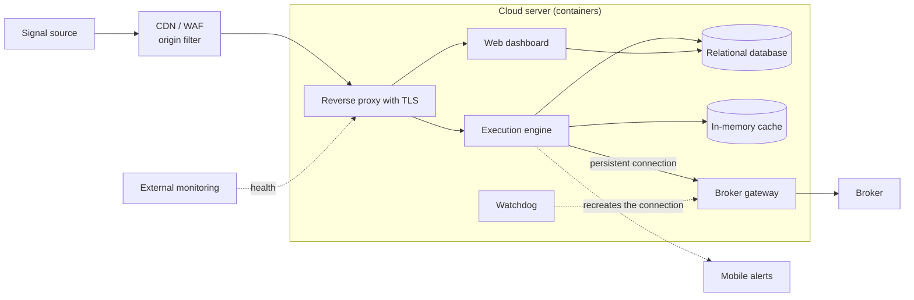

# Automated Order Execution Engine

🇪🇸 [Versión en español](README.es.md)

> **Status:** in production in paper-trading mode and in daily use since October 2026. Moving to live trading is pending authentication and monitoring adjustments.
> **Role:** end-to-end project lead.

A platform that receives trading signals generated in an external tool and turns them into broker orders, with no manual intervention and around the clock. Every trade is recorded from start to finish, and results can be reviewed by day, week and month in a control dashboard.

Previously, execution relied on fragile processes and there was no reliable way to know the real outcome.

---

## 🧭 My role and approach

I don't write the code: it is produced by AI assistants under my direction and review.

- **Goals and phases:** first a minimal working flow, then robustness, and finally replicability.
- **Architecture and stack:** I made the technical decisions, including rejecting a simpler proposal that would not hold up in production.
- **Technical priorities:** protection against duplicate orders, automatic recovery and full traceability.
- **Acceptance criteria:** for example, concurrency tests before trusting the system.
- **Operations:** deployment, server management and production incidents.
- **Product and interface:** dashboard redesign with an in-house design system.
- **Documentation:** I commissioned and validated a user manual and a technical guide.

---

## ⚙️ Architecture

- **Perimeter:** a CDN with a WAF only lets traffic from the signal source through. Behind it, a reverse proxy with TLS is the only component exposed to the internet.
- **Execution engine:** an asynchronous service that validates every signal, authenticates it with a per-bot token, and processes it with mutual exclusion and position-state control. It talks to the broker over a single persistent connection and also runs scheduled tasks, such as end-of-session closes and summaries.
- **Broker gateway:** isolated in its own container.
- **Web dashboard:** bot and webhook management, trade history, results summaries and account management with encrypted credentials. Restricted access, not indexed.
- **Data:** a relational database shared by the engine and the dashboard, plus an in-memory cache for frequent validations.
- **Monitoring:** a watchdog recreates the broker connection if it drops; a health endpoint with external monitoring; and mobile alerts with the daily summary and disconnections.

---

## 🧩 Key decisions

### 1. Separate the execution engine from the web dashboard
- **Why:** low latency on the critical path, and a dashboard failure or deployment never blocks an order.
- **Trade-off:** two applications to maintain on a shared database, with coordinated schema changes.

### 2. Remove the task queue and keep the cache as just a cache
- **Why:** fewer moving parts, lower latency and fewer points of failure for a moderate signal volume.
- **Trade-off:** horizontal scaling of processing is given up. If volume grows significantly, the queue will have to come back.

### 3. When in doubt, pause instead of retrying
A per-bot lock and a position state machine guarantee an order is never duplicated. If the broker doesn't confirm, the bot stops.
- **Why:** when money is at stake, a duplicated position is worse than a missed opportunity.
- **Trade-off:** some pauses require manual review, and the confirmation logic had to be tuned to avoid false alarms.

### 4. One isolated instance per account instead of a shared system
- **Why:** full isolation of credentials and risk between accounts, and simpler code.
- **Trade-off:** higher infrastructure cost and repeated deployments. That's why the system is configured entirely by environment and documented for replication.

### 5. Automatic recovery instead of human intervention
The watchdog rebuilds the broker connection after its daily restart and then reconciles the system's state with the broker's.
- **Why:** the system has to keep running without depending on someone watching.
- **Trade-off:** a daily overnight window without service remains, imposed by the broker, and escalation on repeated failures still needs improvement.

---

## ⏳ Evolution

| Date (2026) | Milestone |
| :--- | :--- |
| August | First approach as a monolith with a task queue on a virtual server. Computing signals inside the system was evaluated and rejected in favour of receiving them from outside. |
| September – October | Redesign to version 2.0: engine and dashboard as separate services, no task queue, in independent containers. An audit of the prototype found gaps (no concurrency or state control, hard-coded values) that were fixed before production. |
| October | Hardening: mutual exclusion, automatic and manual kill switch, end-of-session closes, symbol validation, origin-restricted perimeter, watchdog with automatic recovery, and alerts. Ten traceability gaps found in production were closed. |
| November | Dashboard rebuilt with an in-house design system, account management with encrypted credentials, private non-indexed application, and a user manual and technical guide. |

---

## 📊 Results

- Running continuously since early October 2026, in paper-trading mode.
- First complete cycle validated: the financial result matches the broker's to the cent.
- Outages caused by broker disconnections dropped from up to 16 hours, or even days, to the roughly 90-minute overnight window when the broker itself restarts.
- 151 automated tests, including concurrency tests.
- Documentation: a 35-page user manual and an 18-page technical guide.

There are no live-trading results yet, nor volume or latency metrics.

---

## 🛠 Stack

Python · FastAPI (engine) · Django (dashboard) · PostgreSQL · Redis · Docker Compose · Caddy · Cloudflare · DigitalOcean · HTML/CSS/JS without frameworks · pytest.
