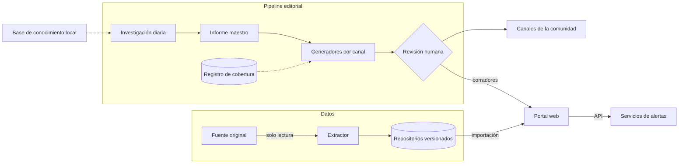

# D2M: Plataforma de inteligencia editorial y datos

> **Estado:** mixto. Pipeline editorial y servicios de alertas en producción; extractor de datos operativo; portal web nuevo en desarrollo.
> **Rol:** director técnico y de producto.

Plataforma para una comunidad de videojuegos de habla hispana que cubre a diario la actualidad de una franquicia con varios títulos activos. Automatiza tres trabajos que antes se hacían a mano: preparar la cobertura editorial, mantener una base de datos de referencia por título y versión, y publicarlo todo en un portal web multilingüe.

---

## 🎯 El problema

- Separar a diario los hechos confirmados de los rumores.
- Publicar en varios canales sin repetir contenido.
- Mantener una base de referencia fiable de los datos de cada título y versión.

Hecho a mano, consumía mucho tiempo y acumulaba errores.

---

## 🧭 Mi rol y método

No programo: defino, decido y valido.

- **Arquitectura:** diseñé el sistema completo y lo dividí en fases con criterios de cierre explícitos.
- **Dirección del desarrollo:** la implementación la ejecutan asistentes de IA de código, que trabajan con especificaciones y reglas de proyecto redactadas por mí.
- **Calidad y seguridad:** fijé las reglas del sistema: solo lectura sobre los datos de origen, validación y tests antes de cada commit, y aprobación humana antes de cualquier publicación.
- **Validación:** contrasto los resultados con la fuente real y apruebo lo que se publica.
- **Operación:** servidor, servicios y despliegue en producción.

---

## ⚙️ Arquitectura

1. **Pipeline editorial.** Un módulo de investigación diaria genera un informe maestro, y de él salen generadores especializados por canal: redes sociales, comunidad, avisos con fecha, resumen semanal, guion de vídeo y respuestas rápidas. Un registro de cobertura con ventana deslizante evita publicar dos veces lo mismo. Nada sale sin revisión humana.
2. **Extractor de datos.** Servicio en contenedor que se lanza con un único comando. Lee la fuente original en solo lectura, con verificación de integridad antes y después, y genera entidades estructuradas multilingües con valores calculados e imágenes optimizadas. Después valida, ejecuta los tests y redacta un changelog legible frente a la versión anterior. Si cualquier paso falla, se detiene sin hacer commit.
3. **Repositorios de datos.** Uno por título, con una carpeta por versión. Todo el historial de cambios es auditable.
4. **Portal web (en reconstrucción).** Monolito modular: taxonomía, noticias, artículos, datos, cuentas, buscadores, API y redirecciones del sitio anterior. Debajo, base de datos relacional, caché, proxy inverso y tareas en segundo plano. Importa los datos de los repositorios y recibe del pipeline editorial borradores pendientes de revisión.
5. **Servicios de alertas.** Bots independientes para la comunidad, que pasarán a usar la API del portal como fuente de verdad.
6. **Base de conocimiento local (prototipo).** Búsqueda vectorial sobre un corpus propio con un modelo de lenguaje local, conectada al módulo de investigación.

---

## 🧩 Decisiones clave

### 1. Reconstruir el portal desde cero, con un lanzamiento único
- **Por qué:** los datos pasan a salir de la fuente original y no de fichas mantenidas a mano, y se evita sostener dos sistemas en paralelo.
- **Contrapartida:** un lanzamiento más arriesgado y más tiempo sin resultados visibles.
- **Mitigación:** entorno local idéntico a producción, migraciones repetibles ensayadas varias veces, staging con datos reales, redirección permanente para cada URL antigua y vuelta atrás por DNS.

### 2. Datos extraídos y versionados, no mantenidos a mano
- **Por qué:** el proceso es reproducible y auditable, y cada nueva versión genera su informe de cambios, que además sirve como fuente propia de noticias.
- **Contrapartida:** más complejidad técnica, casos límite que hay que validar contra la fuente y revisión humana de las imágenes procesadas con IA.

### 3. La automatización propone; una persona aprueba
- **Por qué:** la credibilidad del canal depende de no publicar nunca un rumor como si fuera un hecho.
- **Contrapartida:** el ritmo de publicación depende de una sola persona.

### 4. Contenedores en un único servidor, con un proyecto aislado por servicio
- **Por qué:** coste bajo, entornos idénticos entre local y producción, y operación sencilla.
- **Contrapartida:** punto único de fallo y escalado solo vertical, asumidos de forma consciente para esta escala.

### 5. Login social con la plataforma donde ya vive la comunidad
- **Por qué:** entrar es un clic, no hay contraseñas que custodiar, hay menos spam y se recogen los mínimos datos personales (RGPD).
- **Contrapartida:** dependencia de un tercero, exclusión de quien no use esa plataforma y ningún canal de email propio.

---

## ⏳ Evolución

| Fecha (2026) | Hito |
| :--- | :--- |
| Abril | Primeros servicios de alertas en producción. |
| Mayo – octubre | El pipeline editorial pasa de un único módulo a un sistema de módulos por canal, con registro de cobertura y poda periódica. Cada módulo se versiona con su registro de correcciones; el principal va por su décima versión. |
| Julio – agosto | Primer diseño de un módulo de noticias para convivir con la web existente. Dos iteraciones; la primera se descartó. |
| Octubre | Prototipo de base de conocimiento local con búsqueda vectorial. |
| Noviembre | Cambio de enfoque: portal nuevo desde cero, lanzamiento único y datos procedentes del extractor. Se cierra la fase 0 y se procesa la primera actualización real con el nuevo sistema. |

---

## 📊 Resultados

Cifras de los registros internos del proyecto; no son métricas de audiencia.

- **Pipeline editorial:** en funcionamiento diario desde abril de 2026.
- **Datos:** 37 actualizaciones históricas procesadas, de las que salen 25 versiones de dos títulos, con textos en 13 idiomas y 979 imágenes optimizadas (8,9 MB en total).
- **Reproducibilidad:** 44 tests automáticos; regenerar el conjunto completo produce 4.281 ficheros con 0 diferencias.
- **Contraste con la web anterior:** 1.891 fichas en 291 páginas frente a 1.233 entidades extraídas. Aparecieron 331 errores heredados de la web antigua, que no se migran, y 11 del extractor, que se corrigieron.
- **Primera actualización real:** el sistema detectó una discrepancia entre las notas oficiales y los datos, además de cambios que las notas no mencionaban.

---

## 🛠 Stack

Python · Django · PostgreSQL (campos JSON para el contenido multilingüe; búsqueda vectorial en el prototipo) · Docker y Docker Compose · Git y GitHub · servidor virtual en DigitalOcean · servicios systemd · imágenes WebP con reescalado por IA · modelos de lenguaje en el pipeline editorial y en el desarrollo.
