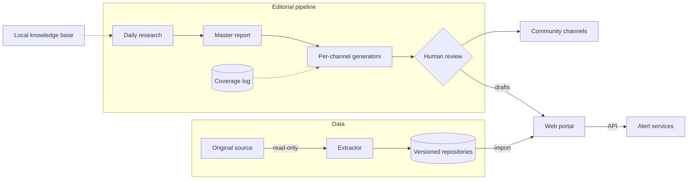

# D2M: Editorial Intelligence and Data Platform

🇪🇸 [Versión en español](README.es.md)

> **Status:** mixed. Editorial pipeline and alert services in production; data extractor operational; new web portal in development.
> **Role:** technical and product lead.

A platform for a Spanish-speaking gaming community that covers, every day, the news around a franchise with several active titles. It automates three jobs that used to be done by hand: preparing editorial coverage, maintaining a reference database per title and version, and publishing all of it on a multilingual web portal.

---

## 🎯 The problem

- Separating confirmed facts from rumours every day.
- Publishing across several channels without repeating content.
- Keeping a reliable reference base for the data of every title and version.

Done by hand, this took a lot of time and accumulated errors.

---

## 🧭 My role and approach

I don't write the code: I define, decide and validate.

- **Architecture:** I designed the whole system and split it into phases with explicit exit criteria.
- **Leading development:** implementation is carried out by AI coding assistants working from specifications and project rules that I wrote.
- **Quality and safety:** I set the system's rules: read-only access to source data, validation and tests before every commit, and human approval before anything is published.
- **Validation:** I check results against the real source and approve what gets published.
- **Operations:** server, services and production deployment.

---

## ⚙️ Architecture

1. **Editorial pipeline.** A daily research module produces a master report, which feeds generators specialised by channel: social media, community, dated announcements, weekly summary, video script and quick replies. A coverage log with a sliding window prevents publishing the same thing twice. Nothing goes out without human review.
2. **Data extractor.** A containerised service launched with a single command. It reads the original source read-only, with integrity checks before and after, and produces structured multilingual entities with computed values and optimised images. It then validates, runs the tests and writes a human-readable changelog against the previous version. If any step fails, it stops without committing.
3. **Data repositories.** One per title, with a folder per version. The full change history is auditable.
4. **Web portal (being rebuilt).** A modular monolith: taxonomy, news, articles, data, accounts, search, API and redirects from the old site. Underneath: relational database, cache, reverse proxy and background jobs. It imports data from the repositories and receives drafts awaiting review from the editorial pipeline.
5. **Alert services.** Independent bots for the community, which will switch to the portal's API as their source of truth.
6. **Local knowledge base (prototype).** Vector search over an in-house corpus with a local language model, connected to the research module.

---

## 🧩 Key decisions

### 1. Rebuild the portal from scratch, with a single launch
- **Why:** data now comes from the original source instead of hand-maintained entries, and there is no need to run two systems in parallel.
- **Trade-off:** a riskier launch and a longer period without visible results.
- **Mitigation:** a local environment identical to production, repeatable migrations rehearsed several times, staging with real data, a permanent redirect for every old URL, and rollback via DNS.

### 2. Extracted, versioned data instead of hand-maintained data
- **Why:** the process is reproducible and auditable, and every new version generates its own change report, which doubles as an in-house news source.
- **Trade-off:** more technical complexity, edge cases that must be validated against the source, and human review of AI-processed images.

### 3. Automation proposes; a human approves
- **Why:** the channel's credibility depends on never publishing a rumour as fact.
- **Trade-off:** publishing pace depends on a single person.

### 4. Containers on a single server, with one isolated project per service
- **Why:** low cost, identical environments between local and production, and simple operations.
- **Trade-off:** single point of failure and vertical-only scaling, consciously accepted at this scale.

### 5. Social login through the platform where the community already lives
- **Why:** one-click sign-in, no passwords to safeguard, less spam, and minimal personal data collected (GDPR).
- **Trade-off:** dependency on a third party, people who don't use that platform are left out, and there is no in-house email channel.

---

## ⏳ Evolution

| Date (2026) | Milestone |
| :--- | :--- |
| April | First alert services in production. |
| May – October | The editorial pipeline grows from a single module into a system of per-channel modules, with a coverage log and periodic pruning. Each module is versioned with its own correction log; the main one is on its tenth version. |
| July – August | First design of a news module meant to coexist with the existing site. Two iterations; the first was discarded. |
| October | Local knowledge base prototype with vector search. |
| November | Change of approach: a new portal from scratch, single launch, with data coming from the extractor. Phase 0 is closed and the first real update is processed with the new system. |

---

## 📊 Results

Figures from the project's internal records; these are not audience metrics.

- **Editorial pipeline:** running daily since April 2026.
- **Data:** 37 historical updates processed, yielding 25 versions across two titles, with text in 13 languages and 979 optimised images (8.9 MB in total).
- **Reproducibility:** 44 automated tests; regenerating the full dataset produces 4,281 files with 0 differences.
- **Comparison with the previous site:** 1,891 entries across 291 pages versus 1,233 extracted entities. It surfaced 331 errors inherited from the old site, which are not migrated, and 11 in the extractor, which were fixed.
- **First real update:** the system detected a discrepancy between the official release notes and the data, as well as changes the notes did not mention.

---

## 🛠 Stack

Python · Django · PostgreSQL (JSON fields for multilingual content; vector search in the prototype) · Docker and Docker Compose · Git and GitHub · DigitalOcean virtual server · systemd services · WebP images with AI upscaling · language models in the editorial pipeline and in development.
