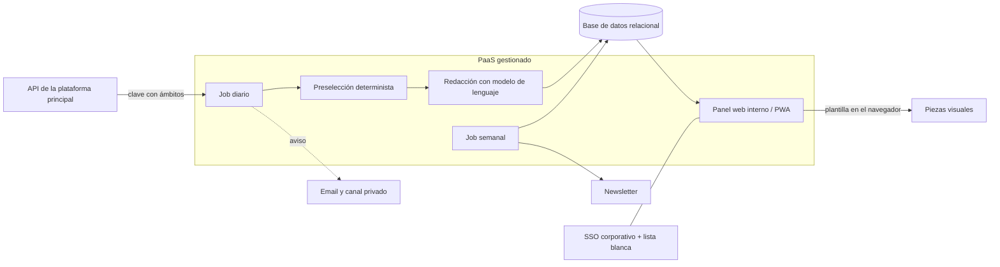

# Motor editorial automatizado

> **Estado:** en producción y en uso diario interno desde agosto de 2026, con evolución activa.
> **Rol:** dirección de producto y técnica, de punta a punta.

Pipeline que convierte cada día un flujo de datos financieros estructurados en contenido editorial listo para publicar: posts para redes, piezas visuales, avisos internos y un newsletter semanal. Elimina el trabajo manual de analizar, redactar y maquetar, y deja la decisión final en manos de un editor humano.

---

## 🧭 Mi rol y método

- **Producto:** definí qué tenía que hacer el sistema.
- **Arquitectura:** tomé las decisiones técnicas y asumí sus contrapartidas.
- **Infraestructura y costes:** elegí la plataforma y el modelo de costes.
- **Seguridad y acceso:** fijé los criterios.
- **Operación:** lo llevé a producción y me ocupo del día a día y de las incidencias.
- **Dirección del desarrollo:** la implementación la hicieron agentes de IA de programación a partir de mis especificaciones, con revisión de cada entrega.

---

## ⚙️ Arquitectura

- **Fuente de datos:** la API interna de la plataforma principal, con autenticación por clave y permisos por ámbito.
- **Job diario programado:** obtiene los datos, aplica una preselección determinista, genera el contenido con un modelo de lenguaje, lo guarda y avisa.
- **Job semanal:** genera y envía un newsletter editorial con el histórico de la semana.
- **Base de datos relacional:** inventario diario, contenido generado, configuración y un registro paso a paso de cada ejecución.
- **Panel web interno:** dashboard, revisión de contenido, generación bajo demanda, histórico, ajustes y log de ejecuciones. Se instala en el móvil como app (PWA).
- **Piezas visuales:** se generan desde plantilla en el navegador del editor, que las descarga listas para publicar.
- **Canales de salida:** email y un canal privado de mensajería, ambos con enlace al panel.
- **Acceso:** login corporativo único (SSO) restringido al dominio, lista blanca y sesiones firmadas.

---

## 🧩 Decisiones clave

### 1. Piezas visuales generadas en el cliente, no en el servidor
- **Por qué:** sin navegador headless en el servidor; menos memoria, menos coste, sin dependencias pesadas y un despliegue ligero.
- **Contrapartida:** la imagen no va incrustada en el email ni en la mensajería; se abre desde un enlace y se descarga a mano.

### 2. Jobs programados efímeros sobre PaaS, en vez de un servidor 24/7
- **Por qué:** solo se paga el tiempo de ejecución, no hay servidores que mantener y el despliegue es automático desde el repositorio.
- **Contrapartida:** dependencia del planificador del proveedor, ejecuciones sin estado y menos control fino del entorno.

### 3. Humano en el bucle: el sistema propone y no publica solo
- **Por qué:** es contenido financiero con riesgo reputacional; el control editorial es innegociable.
- **Contrapartida:** un paso manual por publicación, y el volumen depende del tiempo del editor.

### 4. Preselección determinista antes de la IA
Una capa de reglas reproducible, configurable desde el panel, decide qué merece contenido. El modelo de lenguaje solo redacta.
- **Por qué:** coste de IA acotado, resultados predecibles y auditables, y menos alucinaciones en la selección.
- **Contrapartida:** reglas rígidas que hay que ajustar a mano y que pueden dejar fuera casos interesantes.

### 5. Base de datos compartida con la plataforma principal, con esquema e identidad propios
- **Por qué:** reutiliza infraestructura existente sin acoplar los ciclos de despliegue ni la autenticación.
- **Contrapartida:** dos sistemas de identidad que mantener, y la separación entre esquemas depende de convenciones.

---

## ⏳ Evolución

| Versión | Qué cambió |
| :--- | :--- |
| v0 | Generador visual en un solo HTML y prompt editorial usados a mano, pegando los datos en un chat. |
| v1 | Primer pipeline automatizado con renderizado de imágenes en el servidor. Descartado por coste y peso. |
| v2 | Reescrito como panel web con base de datos y job programado. El login, que iba a delegarse en la plataforma principal, pasó a un SSO corporativo propio para desacoplar ambos sistemas. |
| Refactor | El servidor monolítico (~900 líneas) pasó a routers modulares (~60 líneas en el servidor), las vistas a plantillas y los estilos a un sistema de tokens de diseño. |
| Ampliaciones | Log de ejecuciones, newsletter semanal, sincronización de destinatarios con la plataforma principal, PWA, canal privado de avisos y documentación operativa (runbooks, plan técnico y contexto para agentes de IA). |

---

## 📊 Resultados

- Más de 150 ejecuciones del job diario en producción (finales de octubre de 2026).
- Del orden de 40 activos analizados en una ejecución típica.

No hay datos de audiencia, alcance de las publicaciones ni aperturas del newsletter.

---

## 🛠 Stack

Node.js · Express · plantillas EJS · PostgreSQL gestionado · DigitalOcean (servicio web y jobs programados) con despliegue continuo desde GitHub · SSO corporativo · email transaccional y bot de mensajería · Docker (base de datos local) · modelos de lenguaje.
