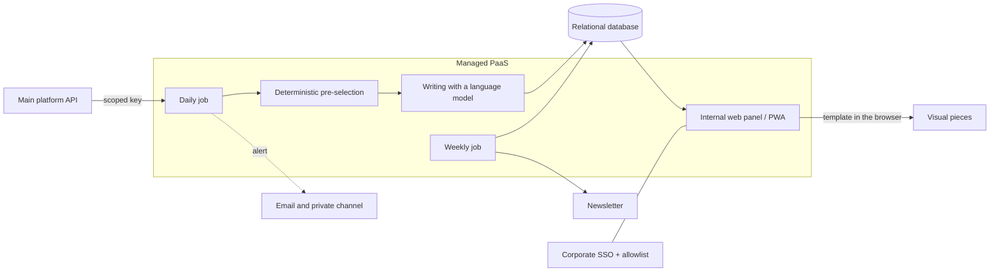

# Automated Editorial Engine

🇪🇸 [Versión en español](README.es.md)

> **Status:** in production and in daily internal use since August 2026, under active development.
> **Role:** end-to-end product and technical lead.

A pipeline that turns a daily stream of structured financial data into publish-ready editorial content: social media posts, visual pieces, internal alerts and a weekly newsletter. It removes the manual work of analysing, writing and laying out, and leaves the final decision to a human editor.

---

## 🧭 My role and approach

- **Product:** I defined what the system had to do.
- **Architecture:** I made the technical decisions and took on their trade-offs.
- **Infrastructure and costs:** I chose the platform and the cost model.
- **Security and access:** I set the criteria.
- **Operations:** I took it to production and handle day-to-day running and incidents.
- **Leading development:** implementation was carried out by AI coding agents from my specifications, with every delivery reviewed.

---

## ⚙️ Architecture

- **Data source:** the main platform's internal API, with key authentication and scoped permissions.
- **Scheduled daily job:** fetches the data, applies a deterministic pre-selection, generates content with a language model, stores it and sends an alert.
- **Weekly job:** generates and sends an editorial newsletter with the week's history.
- **Relational database:** daily inventory, generated content, configuration and a step-by-step log of every run.
- **Internal web panel:** dashboard, content review, on-demand generation, history, settings and run log. It installs on mobile as an app (PWA).
- **Visual pieces:** generated from a template in the editor's browser, which downloads them ready to publish.
- **Output channels:** email and a private messaging channel, both linking to the panel.
- **Access:** corporate single sign-on (SSO) restricted to the domain, an allowlist and signed sessions.

---

## 🧩 Key decisions

### 1. Visual pieces generated on the client, not the server
- **Why:** no headless browser on the server; less memory, lower cost, no heavy dependencies and a lightweight deployment.
- **Trade-off:** the image isn't embedded in the email or the messages; it is opened from a link and downloaded by hand.

### 2. Ephemeral scheduled jobs on a PaaS instead of a 24/7 server
- **Why:** you only pay for execution time, there are no servers to maintain, and deployment is automatic from the repository.
- **Trade-off:** dependence on the provider's scheduler, stateless runs and less fine-grained control of the environment.

### 3. Human in the loop: the system proposes and never publishes on its own
- **Why:** it's financial content with reputational risk; editorial control is non-negotiable.
- **Trade-off:** one manual step per publication, and volume depends on the editor's time.

### 4. Deterministic pre-selection before the AI
A reproducible rules layer, configurable from the panel, decides what deserves content. The language model only writes.
- **Why:** bounded AI cost, predictable and auditable results, and fewer hallucinations in what gets selected.
- **Trade-off:** rigid rules that must be tuned by hand and may leave out interesting cases.

### 5. A database shared with the main platform, with its own schema and identity
- **Why:** reuses existing infrastructure without coupling deployment cycles or authentication.
- **Trade-off:** two identity systems to maintain, and the separation between schemas relies on conventions.

---

## ⏳ Evolution

| Version | What changed |
| :--- | :--- |
| v0 | A single-file HTML visual generator and an editorial prompt used by hand, pasting the data into a chat. |
| v1 | First automated pipeline with server-side image rendering. Discarded due to cost and weight. |
| v2 | Rewritten as a web panel with a database and a scheduled job. Login, initially meant to be delegated to the main platform, moved to its own corporate SSO to decouple both systems. |
| Refactor | The monolithic server (~900 lines) moved to modular routers (~60 lines in the server), views moved to templates and styles to a design-token system. |
| Extensions | Run log, weekly newsletter, recipient sync with the main platform, PWA, private alert channel and operational documentation (runbooks, technical plan and context for AI agents). |

---

## 📊 Results

- More than 150 runs of the daily job in production (late October 2026).
- Around 40 assets analysed in a typical run.

There is no data on audience, post reach or newsletter opens.

---

## 🛠 Stack

Node.js · Express · EJS templates · managed PostgreSQL · DigitalOcean (web service and scheduled jobs) with continuous deployment from GitHub · corporate SSO · transactional email and a messaging bot · Docker (local database) · language models.
