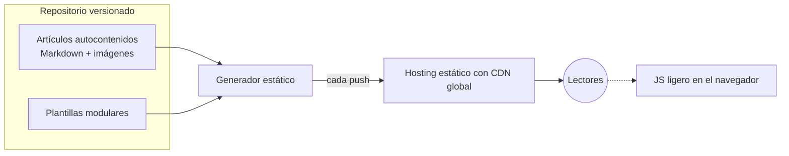

# Portal editorial para una comunidad de esports

🇬🇧 [English version](README.md)

> **Estado:** en producción en su dominio propio.
> **Rol:** dirección técnica completa, de los requisitos a producción.

Migración de un portal de contenidos sobre un videojuego de nicho, que pasó de una aplicación web con servidor a un sitio estático generado desde Markdown y servido por CDN.

---

## 🎯 El problema

El portal funcionaba como aplicación web tradicional en un servidor de pago: coste fijo mensual y mantenimiento técnico para una web que se actualiza poco. Hacía falta una plataforma que:

- tuviera aspecto profesional;
- pudiera mantenerla sola una persona sin perfil técnico;
- costara lo mínimo en alojamiento;
- permitiera publicar artículos, organizarlos por categorías y etiquetas e incrustar vídeo.

---

## 🧭 Mi rol y método

El desarrollo se ejecutó con asistencia de IA bajo mi dirección.

- **Requisitos:** los recogí y los convertí en un documento con decisiones y riesgos registrados.
- **Arquitectura:** elegí el modelo estático con CDN, el generador y el flujo de publicación.
- **Modelo de contenido:** tipos, categorías, etiquetas y organización de recursos.
- **Diseño visual:** del prototipo a las plantillas de producción, con criterios cerrados de paleta, tipografía e interacción.
- **Flujo editorial:** diseñado para que quien mantiene el portal solo tenga que escribir y publicar.
- **Producción:** dominio, DNS, certificados, redirecciones y dominio canónico.

---

## ⚙️ Arquitectura

- **Capa de contenido:** artículos en Markdown con metadatos estructurados. Cada artículo es una carpeta autocontenida con sus imágenes.
- **Capa de presentación:** plantillas modulares (navegación, tarjetas de artículo en tres formatos, bloques temáticos, barra lateral y pie) que se combinan para formar las páginas.
- **Generación:** en cada build, el generador convierte contenido y plantillas en HTML y calcula automáticamente listados, contadores por categoría y páginas de taxonomía.
- **Distribución:** el repositorio está conectado a un hosting estático con CDN global, y cada publicación dispara un despliegue automático.
- **Interactividad:** JavaScript ligero en el navegador, sin backend propio.

---

## 🧩 Decisiones clave

### 1. De aplicación con servidor a sitio 100 % estático en CDN
- **Por qué:** desaparece el coste fijo del servidor, el mantenimiento y la superficie de ataque se reducen casi a cero, y mejora el rendimiento.
- **Contrapartida:** cualquier función dinámica, como mostrar un estado en tiempo real, necesita lógica en el navegador o un servicio externo, lo que rompe el estático puro y añade dependencias.

### 2. Un generador distribuido como ejecutable único, sin dependencias
- **Por qué:** quien mantiene el portal no es técnico, así que no hay entornos que instalar ni paquetes que gestionar, y el build es muy rápido.
- **Contrapartida:** las plantillas son menos flexibles que un framework de componentes. El prototipo de diseño, hecho con componentes reactivos, hubo que traducirlo a plantillas estáticas y separar el estado interactivo en JavaScript aparte. Además, el sitio se reconstruye entero en cada build.

### 3. Publicación desde el repositorio con despliegue automático
- **Por qué:** historial completo de cambios, vuelta atrás y un flujo único: escribir, subir y publicado. La titularidad de las cuentas queda en manos del responsable del portal.
- **Contrapartida:** hay que aprender un flujo mínimo de control de versiones.

### 4. Modelo de contenido unificado
Un solo tipo de contenido, un conjunto cerrado de categorías y etiquetas libres.
- **Por qué:** la portada muestra siempre lo último publicado, sea de la categoría que sea, así que nunca queda vacía aunque una sección tenga poco volumen. Las categorías cerradas mantienen la navegación estable y las etiquetas dan granularidad sin tocar la estructura.
- **Contrapartida:** hace falta una categoría «cajón» para lo que no encaja, y se pierden las plantillas específicas por tipo de contenido.

### 5. Artículos autocontenidos
Contenido e imágenes en la misma carpeta.
- **Por qué:** cada pieza es portable y fácil de revisar, mover o borrar, y las referencias internas no se rompen.
- **Contrapartida:** más carpetas que gestionar e imágenes que no se comparten entre artículos.

---

## ⏳ Evolución

| Área | Antes | Ahora |
| :--- | :--- | :--- |
| Plataforma | Aplicación web dinámica en un servidor virtual de pago. | Sitio estático generado desde Markdown, en hosting con CDN y despliegue continuo. Se arrancó con contenido nuevo y solo se migraron piezas seleccionadas. |
| Diseño | Prototipo visual con componentes reactivos. | Plantillas estáticas modulares con JavaScript mínimo. |
| Contenido | Secciones separadas por tipo y unas ocho categorías temáticas. | Un único tipo de artículo con cinco categorías cerradas y etiquetas libres, para que la portada no dependa del volumen de una sola sección. |

---

## 📊 Resultados

- Sin servidor dedicado ni su coste fijo mensual.
- En producción en el dominio propio, con HTTPS.
- La persona responsable publica sin intervención técnica.

No hay métricas registradas de tráfico ni de rendimiento.

---

## 🛠 Stack

Markdown con front matter · Hugo · HTML, CSS y JavaScript sin frameworks · GitHub con despliegue automático en cada push · hosting estático con CDN, DNS y certificados gestionados · sin base de datos.
