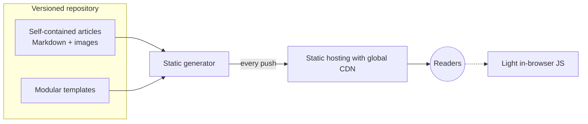

# Editorial Portal for an Esports Community

🇪🇸 [Versión en español](README.es.md)

> **Status:** in production on its own domain.
> **Role:** full technical lead, from requirements to production.

Migration of a content portal about a niche video game from a server-based web application to a static site generated from Markdown and served through a CDN.

---

## 🎯 The problem

The portal ran as a traditional web application on a paid server: a fixed monthly cost and technical maintenance for a site that is rarely updated. It needed a platform that:

- looked professional;
- could be maintained by one non-technical person alone;
- cost as little as possible to host;
- allowed publishing articles, organising them by categories and tags, and embedding video.

---

## 🧭 My role and approach

Development was carried out with AI assistance under my direction.

- **Requirements:** I gathered them and turned them into a document with recorded decisions and risks.
- **Architecture:** I chose the static model with a CDN, the generator and the publishing workflow.
- **Content model:** types, categories, tags and asset organisation.
- **Visual design:** from prototype to production templates, with fixed criteria for palette, typography and interaction.
- **Editorial workflow:** designed so that whoever maintains the portal only has to write and publish.
- **Production:** domain, DNS, certificates, redirects and canonical domain.

---

## ⚙️ Architecture

- **Content layer:** articles in Markdown with structured metadata. Each article is a self-contained folder with its images.
- **Presentation layer:** modular templates (navigation, article cards in three formats, themed blocks, sidebar and footer) combined to build the pages.
- **Generation:** on every build, the generator turns content and templates into HTML and automatically computes listings, per-category counts and taxonomy pages.
- **Delivery:** the repository is connected to static hosting with a global CDN, and every publication triggers an automatic deployment.
- **Interactivity:** light in-browser JavaScript, with no backend of its own.

---

## 🧩 Key decisions

### 1. From a server-based application to a 100% static site on a CDN
- **Why:** the fixed server cost disappears, maintenance and attack surface drop to almost nothing, and performance improves.
- **Trade-off:** any dynamic feature, such as showing a real-time status, needs in-browser logic or an external service, which breaks pure static and adds dependencies.

### 2. A generator distributed as a single, dependency-free executable
- **Why:** the person maintaining the portal isn't technical, so there are no environments to install or packages to manage, and builds are very fast.
- **Trade-off:** templates are less flexible than a component framework. The design prototype, built with reactive components, had to be translated into static templates with interactive state split out into separate JavaScript. The site is also rebuilt in full on every build.

### 3. Publishing from the repository with automatic deployment
- **Why:** full change history, rollback, and a single flow: write, push, published. Account ownership stays with whoever runs the portal.
- **Trade-off:** a minimal version-control workflow has to be learned.

### 4. A unified content model
A single content type, a closed set of categories and free tags.
- **Why:** the home page always shows the latest content, whatever its category, so it is never empty even when a section has little volume. Closed categories keep navigation stable and tags add granularity without touching the structure.
- **Trade-off:** a catch-all category is needed for what doesn't fit, and type-specific templates are lost.

### 5. Self-contained articles
Content and images in the same folder.
- **Why:** each piece is portable and easy to review, move or delete, and internal references don't break.
- **Trade-off:** more folders to manage, and images aren't shared between articles.

---

## ⏳ Evolution

| Area | Before | Now |
| :--- | :--- | :--- |
| Platform | Dynamic web application on a paid virtual server. | Static site generated from Markdown, on CDN hosting with continuous deployment. It started with fresh content, migrating only selected pieces. |
| Design | Visual prototype with reactive components. | Modular static templates with minimal JavaScript. |
| Content | Sections separated by type and about eight thematic categories. | A single article type with five closed categories and free tags, so the home page doesn't depend on the volume of any one section. |

---

## 📊 Results

- No dedicated server and no fixed monthly cost.
- In production on its own domain, with HTTPS.
- The person in charge publishes without technical help.

No traffic or performance metrics have been recorded.

---

## 🛠 Stack

Markdown with front matter · Hugo · HTML, CSS and JavaScript without frameworks · GitHub with automatic deployment on every push · static hosting with CDN, managed DNS and certificates · no database.
