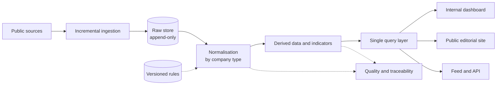

# Normalised Financial Data Hub

🇪🇸 [Versión en español](README.es.md)

> **Status:** advanced development. The core runs daily in my own environment; the public website is built and cloud deployment is planned.
> **Role:** end-to-end development lead.

A platform that collects, processes and publishes financial information about listed companies, serving it to other applications and to readers through an editorial website and an API.

---

## 🎯 The problem

The financial information that listed companies publish is public, but it arrives raw:

- Each company labels it in its own way.
- Criteria change over the years.
- It varies a lot from sector to sector.

Comparing companies or reading them properly takes a lot of manual work. The system standardises this information, computes reliable and comparable indicators, and links every figure to the original document it comes from.

---

## 🧭 My role and approach

I don't write the code: development is carried out by AI coding assistants under my direction. I set the rules, review the results and validate in a real environment.

- **Architecture:** how the system is divided, where each piece of data lives and what can be recomputed.
- **Data quality:** the core rule is never to publish an invented figure.
- **Batch validation with real data:** from 5 to 25, 50, 600 and around 1,000 companies. Each phase is verified in my own environment before it is closed.
- **Priorities:** roadmap order and the scope of each version.
- **Production:** infrastructure, cost, backups and task schedule.
- **Product:** website design, privacy (no cookies on public pages), SEO and a phased launch.
- **Integration:** the contract with the applications that consume the data.

---

## ⚙️ Architecture

A staged flow in which no piece knows who calls it or where its input comes from.

1. **Incremental ingestion:** it first checks whether there is anything new and only then downloads. It respects the source's limits and retries on failure.
2. **Raw data store:** append-only, never overwritten. Compressed, with atomic writes. It is the basis for reprocessing everything without downloading again.
3. **Normalisation:** translates heterogeneous data into a common catalogue according to company type. It touches neither the database nor the network, so it is tested directly against real data.
4. **Derived data:** quarterly series, trailing-twelve-month figures, indicators and sector comparisons. All of it can be discarded and recomputed.
5. **Quality and traceability:** technical alerts that close themselves once they stop reproducing, and a log per run and per company, visible on the website.
6. **Single query layer:** everything read for presentation goes through it, so the dashboard, the website and the API use exactly the same source.
7. **Outputs:** an internal verification dashboard, a public editorial website with text generated from the data, and a feed and API for client applications (in design).

---

## 🧩 Key decisions

### 1. Raw data is immutable; everything else is recomputed
- **Why:** a rule can be changed and everything reprocessed offline, and any figure can be audited.
- **Trade-off:** more storage and full reprocessing after every change. A safeguard was needed: an empty reprocess never deletes anything, and a sudden drop in data is not saved without confirmation.

### 2. A gap rather than an invented number, and every figure linked to its source
- **Why:** reliability is what sets the product apart.
- **Trade-off:** lower apparent coverage and visible gaps. Some standard indicators are not computed for certain sectors, because they would be misleading.

### 3. Decoupled stages and a single read layer, enforced by tests
- **Why:** every piece is tested on its own, the website, API and dashboard never diverge, and an internal data provider can become a product with several clients.
- **Trade-off:** more layers and indirection, plus mandatory discipline: a test prevents bypassing the read layer.

### 4. Rules and exceptions in versioned files, never edited by hand in the database
- **Why:** it came out of a real incident, a manual adjustment made in one environment that never reached the other. Since then, every classification decision is reproducible.
- **Trade-off:** every adjustment goes through the repository and a load command. It is less agile.

### 5. Minimal deployment
A single server, with no distributed queues or cache, and tasks in the system scheduler.
- **Why:** an expected cost of about $17 a month including backups, fewer parts to maintain, and scaling based on explicit criteria (memory use, universe size, opening to the public).
- **Trade-off:** no concurrency or high availability at first. Growth will require migrating to distributed tasks.

---

## ⏳ Evolution (August – November 2026)

| Stage | What changed |
| :--- | :--- |
| Prototype | Loose scripts with 5 companies, later ported to a framework with models, migrations and an admin. |
| Incremental ingestion | Detecting new data before downloading, to save requests. |
| Normalisation by company type | Redesigned several times after testing with real data. Separating structural gaps from real errors brought alerts down from 127 to 3 across 25 companies, and from 667 to 360 across 600. |
| Scaling | Derived data and indicators, tested on 25, 50, 600 and about 1,000 companies. |
| Quality and performance audit | Atomic, compressed writes, per-company locking for concurrent processes, and far fewer queries per company. |
| Change of scope | From a data provider for a single application to a hub with several clients and its own product, with a public website and a feed-based integration contract. |

---

## 📊 Results

Figures from the project documentation. There are no external users or usage metrics yet.

- **Volume:** about 1,000 companies processed out of a registered universe of about 8,000, with 2.2 GB of raw data.
- **Indicator coverage for general companies:** operating margin 92.7%, EBITDA 87.7% and ROE 92.0%.
- **Performance after the audit:** from 976 to 29 queries and from 608 to 137 ms per company. Full normalisation of 600 companies takes 73 s.
- **Quality:** 382 automated tests, verified against the real database.
- **Cost:** infrastructure budgeted at about $17 a month.

---

## 🛠 Stack

Python · Django · PostgreSQL · Docker and Docker Compose · server-rendered templates with HTMX · DigitalOcean (server and backups to object storage, planned).
