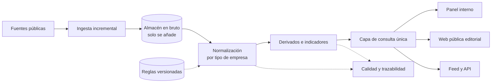

# Hub de datos financieros normalizados

> **Estado:** en desarrollo avanzado. El núcleo funciona a diario en entorno propio; la web pública está construida y el despliegue en la nube está planificado.
> **Rol:** director del desarrollo de principio a fin.

Plataforma que recoge, procesa y publica información financiera de empresas cotizadas, y la sirve a otras aplicaciones y a lectores a través de una web editorial y una API.

---

## 🎯 El problema

La información financiera que publican las empresas cotizadas es pública, pero llega en bruto:

- Cada empresa la etiqueta a su manera.
- Los criterios cambian con los años.
- Varía mucho según el sector.

Compararlas o leerlas bien exige mucho trabajo manual. El sistema homogeneiza esa información, calcula indicadores fiables y comparables, y enlaza cada cifra al documento original del que sale.

---

## 🧭 Mi rol y método

No programo: el desarrollo lo ejecutan asistentes de programación con IA bajo mi dirección. Yo fijo las reglas, reviso los resultados y valido en entorno real.

- **Arquitectura:** cómo se divide el sistema, dónde vive cada dato y qué se puede recalcular.
- **Calidad de datos:** el criterio central es no publicar nunca una cifra inventada.
- **Validación por tandas con datos reales:** de 5 a 25, 50, 600 y unas 1.000 empresas. Cada fase se verifica en mi propio entorno antes de darla por cerrada.
- **Prioridades:** orden del roadmap y alcance de cada versión.
- **Producción:** infraestructura, coste, copias de seguridad y calendario de tareas.
- **Producto:** diseño de la web, privacidad (sin cookies en las páginas públicas), SEO y lanzamiento por fases.
- **Integración:** el contrato con las aplicaciones que consumen los datos.

---

## ⚙️ Arquitectura

Un flujo por etapas en el que cada pieza no sabe quién la llama ni de dónde viene lo que recibe.

1. **Ingesta incremental:** comprueba primero si hay algo nuevo y solo entonces descarga. Respeta los límites de la fuente y reintenta ante fallos.
2. **Almacén de datos en bruto:** solo se añade, nunca se sobrescribe. Comprimido y con escritura atómica. Es la base para reprocesar todo sin volver a descargar.
3. **Normalización:** traduce los datos heterogéneos a un catálogo común según el tipo de empresa. No toca ni base de datos ni red, así que se prueba directamente con datos reales.
4. **Derivados:** series trimestrales, acumulados de 12 meses, indicadores y comparativas sectoriales. Todo se puede descartar y recalcular.
5. **Calidad y trazabilidad:** alertas técnicas que se cierran solas cuando dejan de reproducirse, y un registro por ejecución y por empresa, visible en la web.
6. **Capa de consulta única:** todo lo que se lee para presentar pasa por ella, de modo que el panel, la web y la API usan exactamente la misma fuente.
7. **Salidas:** panel interno de verificación, web pública editorial con textos generados a partir de los datos, y feed y API para aplicaciones cliente (en diseño).

---

## 🧩 Decisiones clave

### 1. Los datos en bruto son inmutables; todo lo demás se recalcula
- **Por qué:** permite cambiar una regla y reprocesarlo todo sin red, y auditar cualquier cifra.
- **Contrapartida:** más almacenamiento y reprocesos completos tras cada cambio. Hizo falta una salvaguarda: un reproceso vacío nunca borra nada, y una caída brusca de datos no se guarda sin confirmación.

### 2. Un hueco antes que un número inventado, y cada cifra enlazada a su origen
- **Por qué:** la fiabilidad es lo que diferencia el producto.
- **Contrapartida:** la cobertura aparente es menor y hay huecos visibles. Algunos indicadores estándar no se calculan en ciertos sectores, porque saldrían engañosos.

### 3. Etapas desacopladas y una sola capa de lectura, vigilada con tests
- **Por qué:** cada pieza se prueba por separado, la web, la API y el panel nunca divergen, y un proveedor interno puede convertirse en un producto con varios clientes.
- **Contrapartida:** más capas e indirección, y disciplina obligatoria: un test impide saltarse la capa de lectura.

### 4. Reglas y excepciones en ficheros versionados, nunca editadas a mano en la base de datos
- **Por qué:** nació de una incidencia real, un ajuste manual hecho en un entorno que no llegó al otro. Desde entonces, toda decisión de clasificación es reproducible.
- **Contrapartida:** cada ajuste pasa por el repositorio y un comando de carga. Es menos ágil.

### 5. Despliegue mínimo
Un único servidor, sin colas distribuidas ni caché, con tareas en el planificador del sistema.
- **Por qué:** coste previsto de unos 17 $ al mes con copias incluidas, menos piezas que mantener y escalado con criterios explícitos (uso de memoria, tamaño del universo, apertura al público).
- **Contrapartida:** sin concurrencia ni alta disponibilidad al principio. Crecer exigirá migrar a tareas distribuidas.

---

## ⏳ Evolución (agosto – noviembre de 2026)

| Etapa | Qué cambió |
| :--- | :--- |
| Prototipo | Scripts sueltos con 5 empresas, portados después a un framework con modelos, migraciones y administración. |
| Ingesta incremental | Detección de novedades antes de descargar, para ahorrar peticiones. |
| Normalización por tipo de empresa | Rediseñada varias veces tras probar con datos reales. Al separar los huecos estructurales de los errores reales, las alertas bajaron de 127 a 3 en 25 empresas, y de 667 a 360 en 600. |
| Escalado | Derivados e indicadores, con pruebas sobre 25, 50, 600 y unas 1.000 empresas. |
| Auditoría de calidad y rendimiento | Escritura atómica y comprimida, bloqueo por empresa para procesos concurrentes y muchas menos consultas por empresa. |
| Cambio de alcance | De proveedor de datos para una sola aplicación a hub con varios clientes y producto propio, con web pública y un contrato de integración por feed. |

---

## 📊 Resultados

Cifras de la documentación del proyecto. Todavía no hay usuarios externos ni métricas de uso.

- **Volumen:** unas 1.000 empresas procesadas sobre un universo registrado de unas 8.000, con 2,2 GB de datos en bruto.
- **Cobertura de indicadores en empresas generales:** margen operativo 92,7 %, EBITDA 87,7 % y ROE 92,0 %.
- **Rendimiento tras la auditoría:** de 976 a 29 consultas y de 608 a 137 ms por empresa. La normalización completa de 600 empresas tarda 73 s.
- **Calidad:** 382 tests automatizados, verificados contra la base de datos real.
- **Coste:** infraestructura prevista de unos 17 $ al mes.

---

## 🛠 Stack

Python · Django · PostgreSQL · Docker y Docker Compose · plantillas renderizadas en servidor con HTMX · DigitalOcean (servidor y copias en almacenamiento de objetos, planificado).
