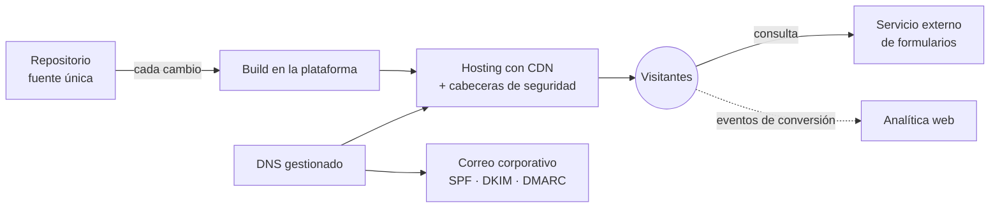

# Web corporativa para un despacho jurídico especializado

> **Estado:** en producción en el dominio propio del despacho, con mejoras de contenido y SEO en curso.
> **Rol:** arquitectura, dirección del desarrollo y migración de principio a fin.

Sitio web estático corporativo con blog, captación de contactos y correo corporativo bajo dominio propio, construido para sacar al despacho de un constructor web cerrado.

---

## 🎯 El problema

El despacho dependía de un constructor web cerrado que controlaba la web, el dominio y el correo. Necesitaba:

- recuperar el control de su presencia digital;
- cargar más rápido y ser más visible en buscadores y motores de IA;
- convertir mejor las visitas en consultas;
- todo con un coste de mantenimiento mínimo.

---

## 🧭 Mi rol y método

Dirigí el desarrollo apoyándome en asistentes de IA para escribir el código.

- **Arquitectura y stack:** los definí yo.
- **Desarrollo:** estructura de páginas, plantillas, blog, rendimiento y seguridad.
- **Migración:** planifiqué y ejecuté el traslado del dominio y del correo desde la plataforma anterior, reduciendo al mínimo la interrupción.
- **Producción:** despliegue continuo y paso a producción.
- **Propiedad:** traspasé la infraestructura a cuentas del despacho, con acceso delegado para mí.
- **Incidencias:** diagnóstico y solución en producción (formularios, contenido embebido y diferencias entre el entorno local y el de producción).

---

## ⚙️ Arquitectura

- **Repositorio de código fuente:** única fuente de verdad del sitio.
- **Generador estático:** convierte plantillas y contenido en HTML durante el build.
- **Hosting con CDN:** compila automáticamente con cada cambio del repositorio y sirve el sitio desde el borde de la red.
- **DNS gestionado:** en el mismo proveedor que el hosting; enruta la web y el correo.
- **Correo corporativo:** en una suite de productividad, con autenticación de correo (SPF, DKIM y DMARC).
- **Formulario de contacto:** mediante un servicio externo, sin backend propio.
- **Analítica web:** mide los eventos de conversión.
- **Seguridad:** cabeceras HTTP declaradas en el propio repositorio.

---

## 🧩 Decisiones clave

### 1. Sitio estático en lugar de un CMS o un constructor visual
- **Por qué:** más velocidad, menos superficie de ataque y alojamiento prácticamente gratuito.
- **Contrapartida:** editar exige un flujo con repositorio; no hay editor visual.

### 2. Build en la plataforma de hosting con cada cambio del repositorio
- **Por qué:** despliegues reproducibles, sin depender de una máquina local, y vuelta atrás sencilla.
- **Contrapartida:** dependencia de la plataforma y necesidad de fijar la versión del generador para evitar diferencias entre entornos.

### 3. Salir de la plataforma anterior y unificar dominio, DNS y correo bajo control del despacho
- **Por qué:** propiedad real de los activos digitales y libertad para elegir proveedor.
- **Contrapartida:** una ventana de corte del correo imposible de eliminar del todo, y más coordinación entre varias partes.

### 4. De una sola página a varias páginas independientes, más un blog
- **Por qué:** cada página tiene su URL, sus metadatos y sus datos estructurados, lo que mejora el SEO, el posicionamiento local y la visibilidad en motores de IA.
- **Contrapartida:** más plantillas que mantener, y los cambios de URL exigen redirecciones.

### 5. Política de seguridad de contenido estricta y recursos alojados en el propio sitio
- **Por qué:** seguridad, privacidad y rendimiento; las fuentes tipográficas se sirven desde el propio dominio.
- **Contrapartida:** cada servicio externo nuevo (vídeos, formularios, analítica) hay que autorizarlo de forma explícita. Quedó demostrado cuando el contenido embebido falló en producción.

---

## ⏳ Evolución

1. Web original en un constructor cerrado.
2. Plantilla de una sola página sobre el generador estático, como prueba de concepto.
3. Separación en páginas independientes por área y por perfil.
4. Despliegue continuo y migración de dominio y correo.
5. Endurecimiento de la seguridad, optimización del rendimiento (precarga de fuentes y caché de recursos estáticos) y medición de conversiones.
6. Blog con optimización para buscadores y motores de IA.

---

## 📊 Resultados

- En producción en el dominio propio, con la web, el dominio y el correo bajo control del despacho.
- Coste de infraestructura de unos 9 € al año, que corresponden solo al dominio: hosting, CDN y certificados entran en el plan gratuito.

No hay cifras medidas de tráfico, conversiones ni rendimiento.

---

## 🛠 Stack

Hugo · HTML, CSS y JavaScript sin frameworks · Git y GitHub · hosting estático con CDN, DNS y registro de dominio gestionados · suite de correo corporativo · analítica web · servicio externo de formularios · sin base de datos.
