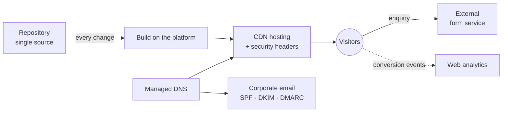

# Corporate Website for a Specialist Law Firm

🇪🇸 [Versión en español](README.es.md)

> **Status:** in production on the firm's own domain, with content and SEO improvements ongoing.
> **Role:** architecture, development lead and migration, end to end.

A static corporate website with a blog, lead capture and corporate email on the firm's own domain, built to move the firm off a closed website builder.

---

## 🎯 The problem

The firm depended on a closed website builder that controlled its website, domain and email. It needed to:

- regain control of its digital presence;
- load faster and be more visible in search engines and AI engines;
- convert more visits into enquiries;
- all with minimal maintenance cost.

---

## 🧭 My role and approach

I led development using AI assistants to write the code.

- **Architecture and stack:** defined by me.
- **Development:** page structure, templates, blog, performance and security.
- **Migration:** I planned and carried out the move of the domain and email from the previous platform, keeping disruption to a minimum.
- **Production:** continuous deployment and go-live.
- **Ownership:** I transferred the infrastructure to accounts owned by the firm, with delegated access for me.
- **Incidents:** diagnosis and fixes in production (forms, embedded content and differences between the local and production environments).

---

## ⚙️ Architecture

- **Source code repository:** the site's single source of truth.
- **Static generator:** turns templates and content into HTML at build time.
- **CDN hosting:** builds automatically on every repository change and serves the site from the network edge.
- **Managed DNS:** with the same provider as the hosting; routes both website and email.
- **Corporate email:** on a productivity suite, with email authentication (SPF, DKIM and DMARC).
- **Contact form:** through an external service, with no backend of its own.
- **Web analytics:** tracks conversion events.
- **Security:** HTTP headers declared in the repository itself.

---

## 🧩 Key decisions

### 1. A static site instead of a CMS or a visual builder
- **Why:** more speed, less attack surface and practically free hosting.
- **Trade-off:** editing requires a repository workflow; there is no visual editor.

### 2. Builds on the hosting platform, triggered by every repository change
- **Why:** reproducible deployments, no dependence on a local machine, and easy rollback.
- **Trade-off:** dependence on the platform and the need to pin the generator version to avoid differences between environments.

### 3. Leave the previous platform and bring domain, DNS and email under the firm's control
- **Why:** real ownership of the digital assets and freedom to choose providers.
- **Trade-off:** an email cut-over window that can't be fully eliminated, and more coordination between several parties.

### 4. From a single page to several independent pages, plus a blog
- **Why:** each page has its own URL, metadata and structured data, which improves SEO, local positioning and visibility in AI engines.
- **Trade-off:** more templates to maintain, and URL changes require redirects.

### 5. A strict content security policy and self-hosted assets
- **Why:** security, privacy and performance; fonts are served from the site's own domain.
- **Trade-off:** every new external service (videos, forms, analytics) must be explicitly allowed. This became clear when embedded content failed in production.

---

## ⏳ Evolution

1. Original website on a closed builder.
2. Single-page template on the static generator, as a proof of concept.
3. Split into independent pages by practice area and by profile.
4. Continuous deployment and domain and email migration.
5. Security hardening, performance optimisation (font preloading and static asset caching) and conversion tracking.
6. Blog optimised for search engines and AI engines.

---

## 📊 Results

- In production on its own domain, with the website, domain and email under the firm's control.
- Infrastructure cost of about €9 a year, which covers only the domain: hosting, CDN and certificates fall within the free plan.

No traffic, conversion or performance figures have been measured.

---

## 🛠 Stack

Hugo · HTML, CSS and JavaScript without frameworks · Git and GitHub · static hosting with CDN, managed DNS and domain registration · corporate email suite · web analytics · external form service · no database.
