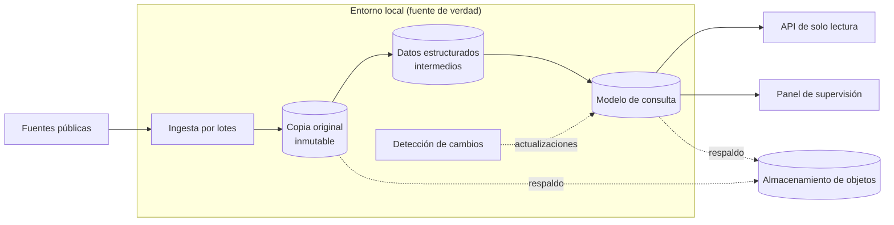

# Plataforma de agregación de datos estadísticos

🇬🇧 [English version](README.md)

> **Estado:** prototipo operativo en entorno local, con API, panel y respaldo verificado. Pendiente del despliegue en la nube y de incorporar nuevas fuentes.
> **Rol:** dirección técnica y de producto.

Plataforma que recoge datos estadísticos públicos de varios organismos, los guarda en una base propia y los sirve mediante una API de consulta única y estable.

---

## 🎯 El problema

Los datos estadísticos públicos están repartidos entre varios organismos, y cada uno:

- usa sus propios formatos, códigos y calendarios;
- corrige sus cifras con el tiempo.

Quien quiere usarlos tiene que conocer cómo funciona cada fuente. El sistema absorbe esa complejidad y ofrece una sola interfaz estable.

---

## 🧭 Mi rol y método

La implementación la dirigí mediante especificaciones y revisión, no programando: la ejecutaron asistentes de IA a partir de esas especificaciones.

- **Objetivo y alcance** del producto.
- **Arquitectura** y decisiones técnicas.
- **Secuencia:** qué se construye, en qué orden y qué se deja preparado pero sin activar.
- **Calidad y trazabilidad** de los datos.
- **Operación:** llevé el sistema hasta un entorno operativo con respaldo verificado.

---

## ⚙️ Arquitectura

- **Ingesta:** un proceso por lotes descarga los datos de origen y los hace pasar por etapas: copia original intacta, datos estructurados intermedios y modelo final de consulta. Cada etapa guarda su resultado y registra lo que hizo.
- **Servicio:** una API de solo lectura que consulta únicamente la base propia y nunca llama a fuentes externas en tiempo real, más un panel interno de supervisión.
- **Detección de cambios:** un proceso aparte compara cada nueva publicación de la fuente con lo ya guardado y prepara las actualizaciones, que se aplican en un paso separado.
- **Respaldo:** copia de los datos irrecuperables y de la base en almacenamiento de objetos, con la restauración probada de punta a punta.
- **Acoplamiento mínimo:** ingesta y servicio solo se comunican a través de la base de datos.

---

## 🧩 Decisiones clave

### 1. Separar ingesta y servicio
- **Por qué:** si una fuente cae o cambia de formato, falla la ingesta, no la API.
- **Contrapartida:** los datos llegan con cierto retraso respecto a la fuente, y hace falta almacenamiento y un pipeline propios.

### 2. Pipeline por etapas con copia original inmutable y registro de ejecución
- **Por qué:** un error de interpretación se corrige reprocesando desde lo guardado, sin volver a descargar, y cada fallo deja rastro.
- **Contrapartida:** más almacenamiento por cada edición descargada y más piezas que mantener.

### 3. Ingesta en local y solo la capa de consulta en la nube
- **Por qué:** los datos cambian despacio, así que la parte en la nube puede ser mínima y estable.
- **Contrapartida:** la máquina local pasa a ser la fuente de verdad. Eso obligó a montar un respaldo con restauración probada, cuyo destino se cambia solo con configuración.

### 4. API con consultas dinámicas en lugar de ficheros estáticos
- **Por qué:** permite filtrar y pedir solo lo que ha cambiado desde una fecha.
- **Contrapartida:** hay que mantener un servidor en vez de un simple alojamiento de ficheros.

### 5. Automatizar por fases
La actualización incremental y el respaldo están construidos y probados, pero se lanzan a mano hasta haber observado ciclos reales de publicación.
- **Por qué:** no automatizar un comportamiento que todavía no se conoce.
- **Contrapartida:** operación manual mientras tanto.

---

## ⏳ Evolución

| Etapa | Qué cambió |
| :--- | :--- |
| Idea inicial | Un intermediario con autenticación por delante de las APIs públicas. |
| Primer cambio | Ingesta propia y API independiente, para no depender de terceros en tiempo real. |
| Infraestructura | El plan de desplegarlo todo en la nube se sustituyó por el reparto entre entorno local y nube. |
| Después | Respaldo, detección incremental de cambios y documentación operativa. |

---

## 📊 Resultados

- Primera fuente cargada, con unos 9 millones de observaciones.
- Restauración completa desde el respaldo, verificada comparando conteos.

Todavía no hay datos de usuarios, tráfico ni rendimiento.

---

## 🛠 Stack

Python · FastAPI · PostgreSQL · Docker Compose · migraciones de esquema versionadas · almacenamiento de objetos compatible con S3.
