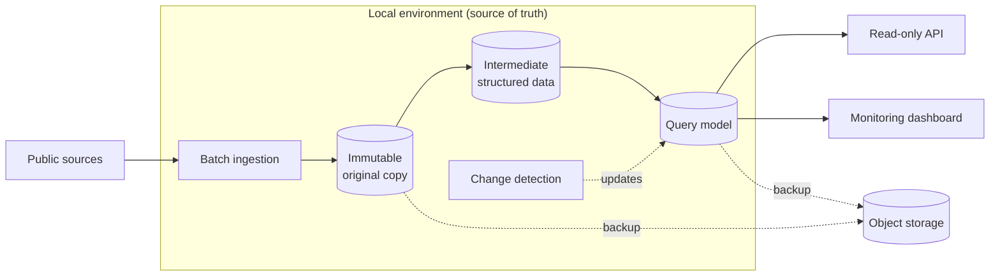

# Statistical Data Aggregation Platform

🇪🇸 [Versión en español](README.es.md)

> **Status:** working prototype in a local environment, with API, dashboard and verified backups. Cloud deployment and new sources are pending.
> **Role:** technical and product lead.

A platform that collects public statistical data from several agencies, stores it in its own database and serves it through a single, stable query API.

---

## 🎯 The problem

Public statistical data is spread across several agencies, and each one:

- uses its own formats, codes and release calendars;
- revises its figures over time.

Anyone who wants to use the data has to understand how each source works. The system absorbs that complexity and offers a single, stable interface.

---

## 🧭 My role and approach

I led the implementation through specifications and review, not by programming: AI assistants carried it out from those specifications.

- **Goal and scope** of the product.
- **Architecture** and technical decisions.
- **Sequencing:** what gets built, in what order, and what is left ready but switched off.
- **Data quality and traceability.**
- **Operations:** I took the system to a working environment with verified backups.

---

## ⚙️ Architecture

- **Ingestion:** a batch process downloads the source data and passes it through stages: untouched original copy, intermediate structured data and final query model. Each stage stores its output and logs what it did.
- **Serving:** a read-only API that only queries the platform's own database and never calls external sources in real time, plus an internal monitoring dashboard.
- **Change detection:** a separate process compares each new release from the source with what is already stored and prepares the updates, which are applied in a separate step.
- **Backups:** copies of irreplaceable data and of the database in object storage, with restores tested end to end.
- **Minimal coupling:** ingestion and serving only communicate through the database.

---

## 🧩 Key decisions

### 1. Separate ingestion from serving
- **Why:** if a source goes down or changes format, ingestion fails, not the API.
- **Trade-off:** data lags somewhat behind the source, and dedicated storage and a pipeline are needed.

### 2. Staged pipeline with an immutable original copy and run logs
- **Why:** an interpretation error is fixed by reprocessing from what is stored, without downloading again, and every failure leaves a trace.
- **Trade-off:** more storage per downloaded release and more parts to maintain.

### 3. Ingestion stays local; only the query layer goes to the cloud
- **Why:** the data changes slowly, so the cloud side can stay minimal and stable.
- **Trade-off:** the local machine becomes the source of truth. That required backups with tested restores, whose destination can be swapped through configuration alone.

### 4. An API with dynamic queries instead of static files
- **Why:** it allows filtering and requesting only what has changed since a given date.
- **Trade-off:** a server has to be maintained instead of simple file hosting.

### 5. Automate in phases
Incremental updates and backups are built and tested, but they are run by hand until real release cycles have been observed.
- **Why:** to avoid automating behaviour that isn't yet understood.
- **Trade-off:** manual operation in the meantime.

---

## ⏳ Evolution

| Stage | What changed |
| :--- | :--- |
| Initial idea | An authenticated intermediary sitting in front of public APIs. |
| First change | In-house ingestion and an independent API, to avoid depending on third parties in real time. |
| Infrastructure | The plan to deploy everything to the cloud was replaced by a split between local environment and cloud. |
| Afterwards | Backups, incremental change detection and operational documentation. |

---

## 📊 Results

- First source loaded, with about 9 million observations.
- Full restore from backup, verified by comparing record counts.

There is no user, traffic or performance data yet.

---

## 🛠 Stack

Python · FastAPI · PostgreSQL · Docker Compose · versioned schema migrations · S3-compatible object storage.
